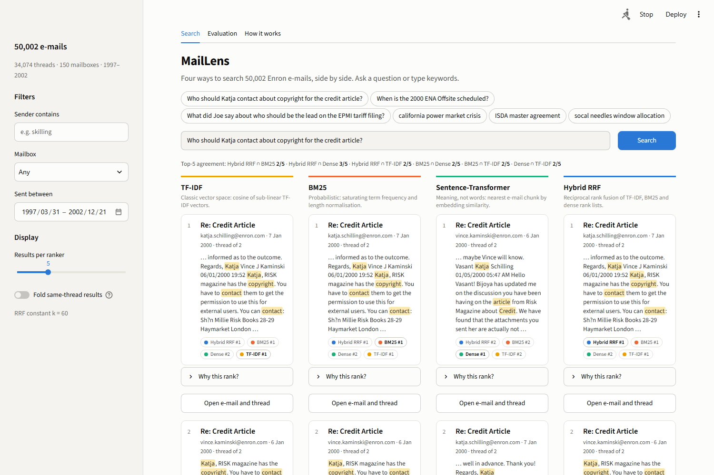
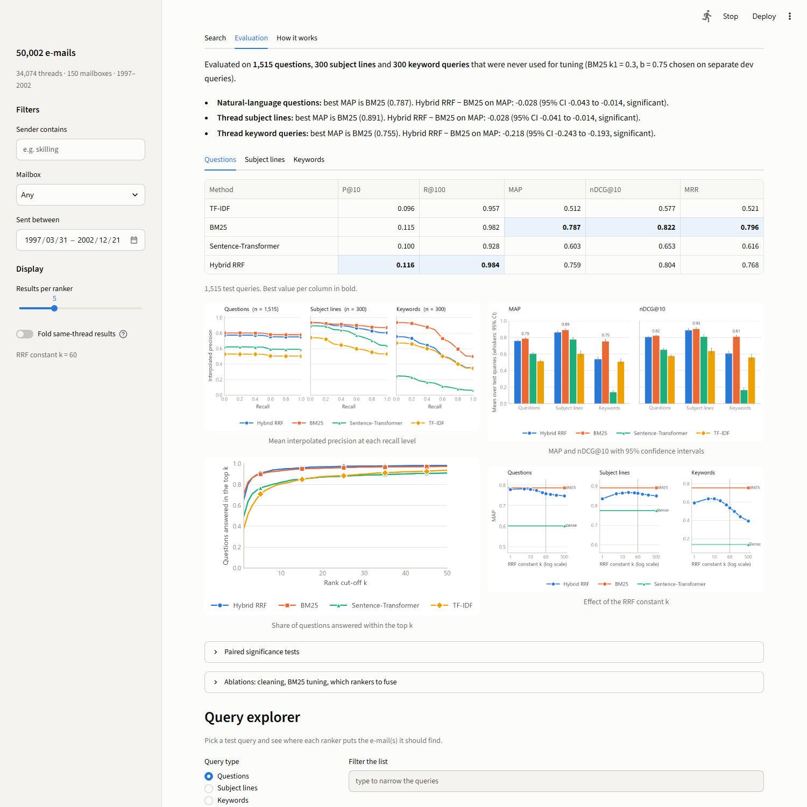
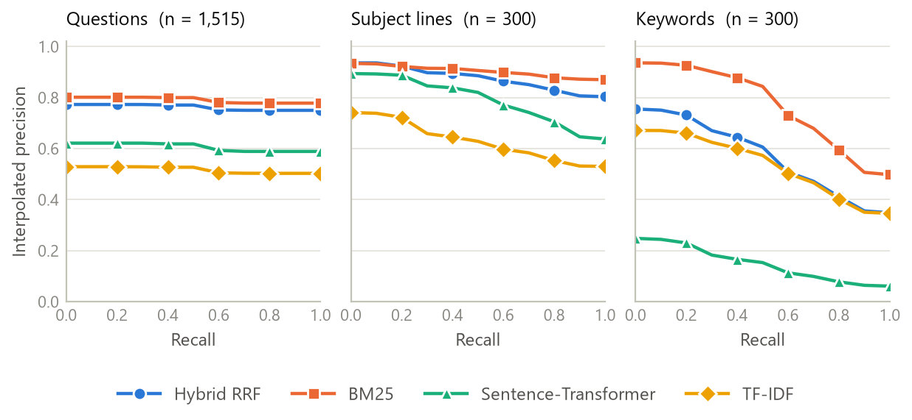

# MailLens

**Four ways to search the Enron e-mails, side by side, and a measurement of which one finds the
right e-mail.**

Course project for *Information Retrieval* (Project 16: e-mail search on the Enron corpus).
MailLens answers one query with **TF-IDF**, **BM25**, a **sentence-transformer** and **hybrid
reciprocal rank fusion (RRF)** over 50,002 real corporate e-mails. It shows where each result
ranks in every list, explains the score, and evaluates all four on thousands of test queries.



*One question, four rankers. The chips on every result say where the other rankers put the same
e-mail; the line above the columns says how much their top lists agree.*



*The evaluation tab: results on the test queries, precision-recall curves, confidence intervals,
the effect of RRF's constant, and a live explorer.*

## What is in it

| Part | How it is built |
|---|---|
| Inverted index | written from scratch: all postings in flat arrays with one offset per term ([`inverted.py`](maillens/index/inverted.py)) |
| TF-IDF and BM25 | written from scratch; tests compare TF-IDF with scikit-learn, BM25 with a plain textbook implementation, and both with hand-computed values |
| Dense retrieval | `all-MiniLM-L6-v2` embeddings of overlapping 140-word chunks; an e-mail scores as its best chunk |
| Hybrid | reciprocal rank fusion with k = 60, plus a sweep over k |
| E-mail cleaning | separates what the sender wrote from quoted and forwarded text (including Lotus Notes layouts), strips legal footers, routing noise, URLs and HTML |
| De-duplication and threads | the dump stores a message once per folder or mailbox it reached, under different IDs, so copies are found by content; threads are rebuilt from subject, people and time |
| Evaluation | P@10, R@100, MAP, nDCG@10, MRR; separate dev and test queries; bootstrap intervals and randomisation tests; ablations |
| App | Streamlit: four columns, per-result rank chips, explanations, a thread viewer, a query explorer |

## Results

Test queries only. BM25's `k1 = 0.3` and `b = 0.75` were chosen on separate dev queries. Best value per column in bold; confidence intervals, significance tests and every ablation are in [`results/`](results/).

**Natural-language questions** (n = 1,515)

| Method | P@10 | R@100 | MAP | nDCG@10 | MRR |
|---|---:|---:|---:|---:|---:|
| TF-IDF | 0.096 | 0.957 | 0.512 | 0.577 | 0.521 |
| BM25 | 0.115 | 0.982 | **0.787** | **0.822** | **0.796** |
| Sentence-Transformer | 0.100 | 0.928 | 0.603 | 0.653 | 0.616 |
| Hybrid RRF | **0.116** | **0.984** | 0.759 | 0.804 | 0.768 |

**Thread subject lines** (n = 300)

| Method | P@10 | R@100 | MAP | nDCG@10 | MRR |
|---|---:|---:|---:|---:|---:|
| TF-IDF | 0.383 | 0.934 | 0.602 | 0.636 | 0.689 |
| BM25 | **0.513** | 0.977 | **0.891** | **0.903** | 0.913 |
| Sentence-Transformer | 0.457 | 0.946 | 0.775 | 0.809 | 0.870 |
| Hybrid RRF | 0.505 | **0.983** | 0.863 | 0.889 | **0.918** |

**Thread keyword queries** (n = 300)

| Method | P@10 | R@100 | MAP | nDCG@10 | MRR |
|---|---:|---:|---:|---:|---:|
| TF-IDF | 0.328 | 0.845 | 0.509 | 0.559 | 0.614 |
| BM25 | **0.429** | **0.881** | **0.755** | **0.807** | **0.924** |
| Sentence-Transformer | 0.095 | 0.341 | 0.138 | 0.164 | 0.226 |
| Hybrid RRF | 0.356 | 0.881 | 0.536 | 0.606 | 0.691 |



What the numbers say:

- **BM25 is the best single ranker on every query kind**, and the equal-weight hybrid is significantly below it (MAP difference -0.028 on questions, -0.028 on subject lines, -0.218 on keyword queries; 95% intervals -0.043 to -0.014, -0.041 to -0.014, -0.243 to -0.193).
- Fusion still helps *finding* the e-mail: the hybrid has the best Recall@100 on questions (0.984 vs 0.982) and subject lines (0.983 vs 0.977), but it puts the right e-mail first less often.
- **TF-IDF trails because cosine normalisation penalises long e-mails**: on questions its MRR falls from 0.651 (answer of at most 50 words) to 0.379 (over 400 words), while BM25 stays between 0.73 and 0.82 (`results/length_analysis.csv`).
- The dense ranker is respectable on questions (MAP 0.603) and subject lines (0.775) but collapses on keyword lists (0.138), which drags the three-way fusion down.
- RRF's constant matters: on keyword queries the hybrid scores 0.636 at k = 5, 0.536 at the standard k = 60 and 0.394 at k = 500; a k between 5 and 20 beat k = 60 on all three query kinds.
- An exploratory fusion that counts BM25 three times reaches 0.791 on questions (BM25 alone 0.787) and 0.890 on subject lines (0.891), but only 0.654 on keywords (0.755).
- Cleaning shrinks the index (111,205 terms against 142,413 on raw text) and leaves questions and keyword queries unchanged (BM25 MAP 0.787 vs 0.783 raw; 0.755 vs 0.757), but lowers subject-line MAP (0.891 vs 0.919); the quoted headers it removes repeat the subject, which probably helps find replies.
- Tuning BM25 helps the thread queries (subject lines 0.891 vs 0.862 with the textbook defaults) but not the questions (0.787 vs 0.794).


## Quick start

Python 3.12 is the tested version.

```bash
py -3.12 -m venv .venv
.venv\Scripts\activate
pip install torch --index-url https://download.pytorch.org/whl/cpu
pip install -r requirements.txt

python -m maillens download    # about 500 MB from Hugging Face
python -m maillens prepare     # de-duplicate, clean, thread, sample (about 1.5 minutes)
python -m maillens index       # TF-IDF and BM25 indexes (about 20 seconds)
python -m maillens embed       # embeddings: about 40 minutes on a laptop CPU, safe to interrupt and resume
python -m maillens queries     # build the question and thread queries
python -m maillens evaluate    # tune on dev queries, report on test queries
python -m maillens analyze     # e-mail length analysis of the results
python -m maillens figures     # draw the figures into results/figures
python -m maillens app         # open the search interface
```

`python -m maillens search "gas storage" -k 5` answers a single query in the terminal. Each stage
is safe to re-run; large files go to `data/` and `artifacts/`, which are git-ignored.

## How the evaluation works

Enron ships without relevance labels, so two automatic sources are used:

1. **Questions.** A published set of natural-language questions, each with the e-mail that answers
   it. 1,515 are test queries; 300 more, drawn from a different part of the set, are dev queries.
2. **Threads.** For 300 test threads (and 100 dev threads) a *subject-line query* and a *keyword
   query* (four characteristic words that are not in the subject); every e-mail of the thread is
   relevant.

BM25's `k1` and `b` are tuned on the dev queries only; every reported number comes from the test
queries. Limits worth knowing: the labels favour known-item lookups; thread reconstruction is a
heuristic; the dense ranker embeds the first four chunks (about 500 words) of each e-mail; and the
corpus is a 50,002-e-mail sample, so absolute scores would be lower on the full corpus. The
walkthrough in [`docs/WALKTHROUGH.md`](docs/WALKTHROUGH.md) explains each decision.

## Repository layout

```
maillens/
  prep/          download, e-mail cleaning, thread reconstruction, corpus sampling
  text/          analyzer (tokens, stop-words, Snowball stems)
  index/         the inverted index
  rankers/       TF-IDF, BM25, dense retrieval, reciprocal rank fusion
  evaluation/    metrics, query sets, runner, experiments, significance tests, figures
  engine.py      one object that answers a query with all four rankers
  app/           the Streamlit interface
  cli.py         the commands above
tests/           pytest suite (every module, plus an end-to-end evaluation on a synthetic corpus)
results/         the numbers and figures behind the results section
docs/            walkthrough of the design and the evaluation
```

## Data and credits

- **Enron e-mail corpus**: Klimt and Yang, *The Enron Corpus: A New Dataset for Email
  Classification Research*, ECML 2004. It is a public release of real corporate e-mail and contains
  personal information, so it is used here for research only.
- E-mails and questions were downloaded from the Hugging Face datasets
  [`corbt/enron-emails`](https://huggingface.co/datasets/corbt/enron-emails) and
  [`corbt/enron_emails_sample_questions`](https://huggingface.co/datasets/corbt/enron_emails_sample_questions);
  neither declares a licence.
- **Sentence-Transformer**: `sentence-transformers/all-MiniLM-L6-v2` (Reimers and Gurevych, 2019).
- **Stemmer**: Snowball (Porter2) from NLTK. Reciprocal rank fusion: Cormack, Clarke and
  Buettcher, SIGIR 2009. BM25: Robertson and Zaragoza, 2009.

## Development

```bash
pip install -r requirements-dev.txt
python -m pytest            # the whole suite
ruff check . && ruff format --check .
mypy maillens
```

`requirements-report.txt` adds the optional tools for building the report, slides and demo video.

## Licence

MIT, see [`LICENSE`](LICENSE).
